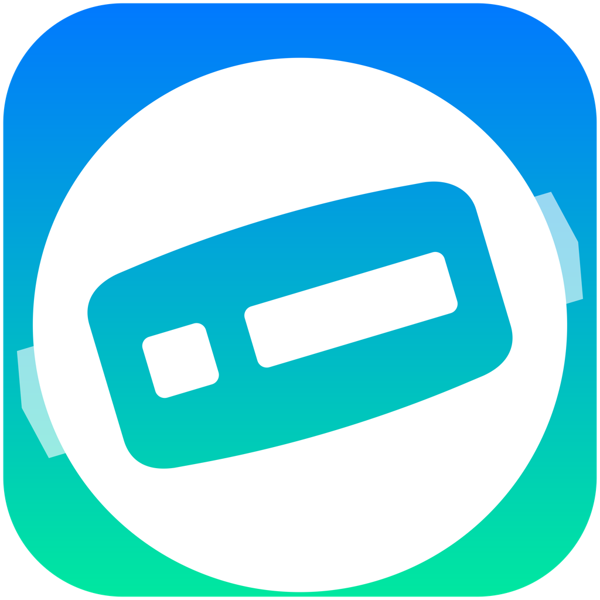
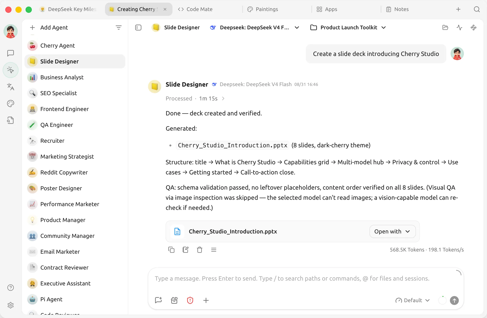
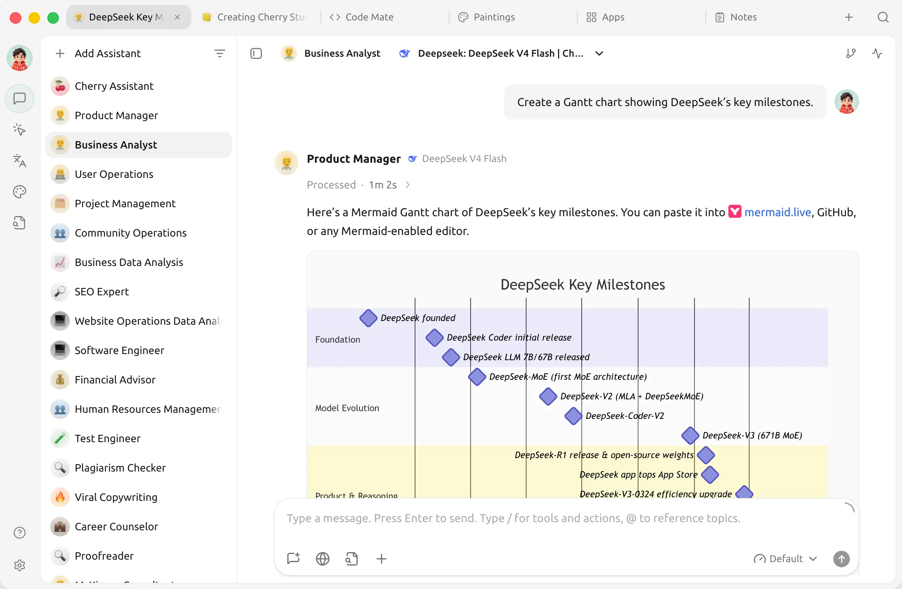
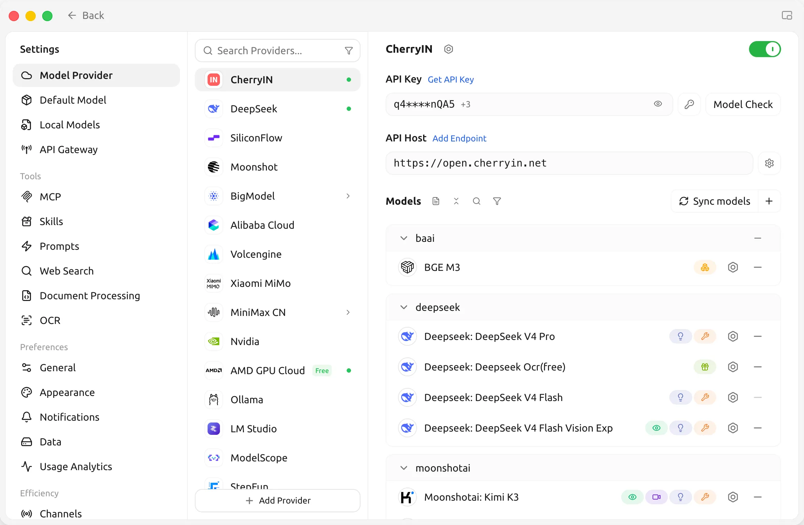
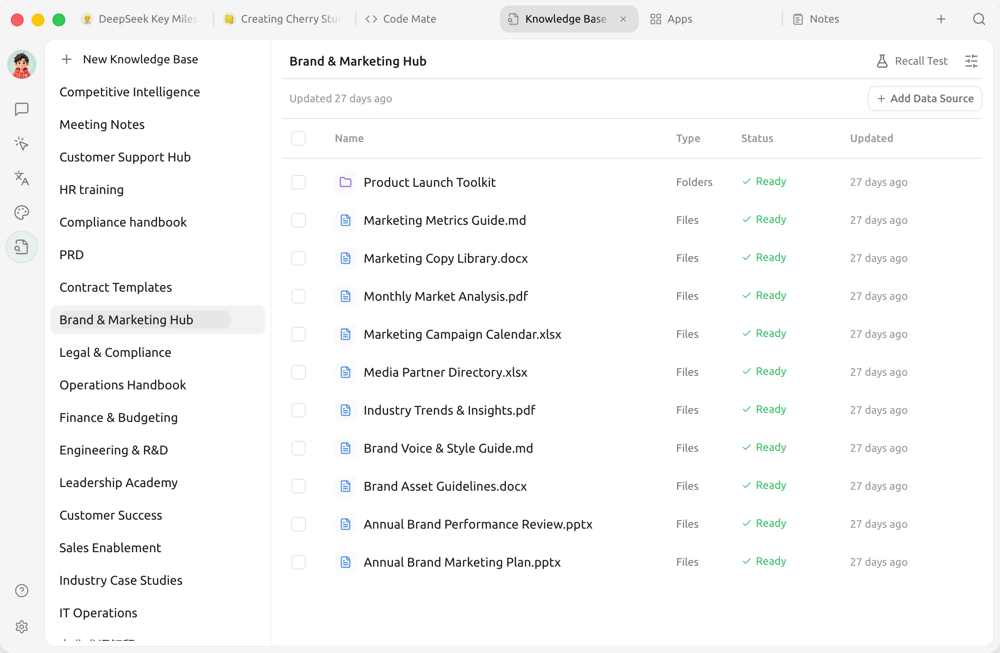
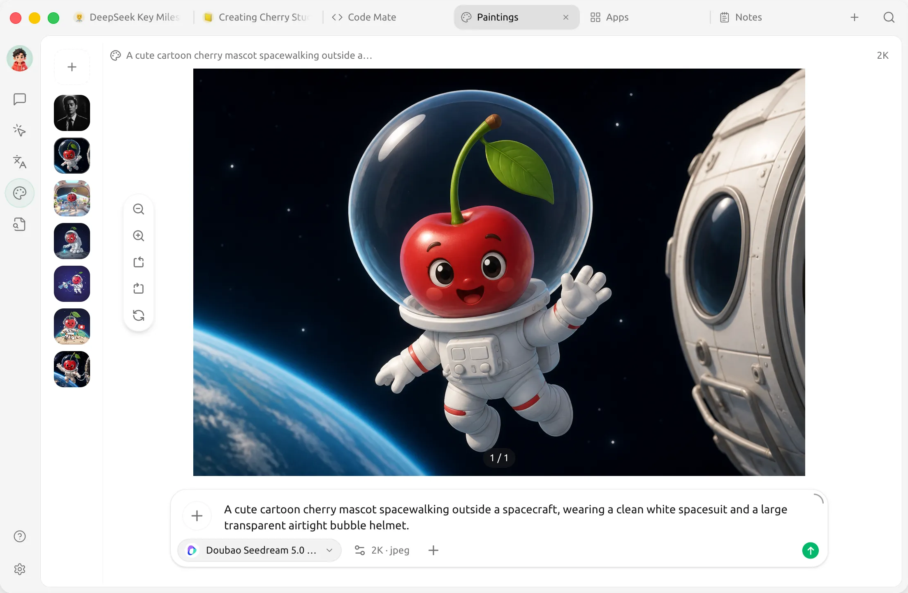

<h1 align="center">
  <a href="https://github.com/CherryHQ/cherry-studio/releases">
     
  </a>
</h1>

English | <a href="./docs/dev/contrib/development.md">Development</a> 

<!-- Feedback entry temporarily hidden. -->

[![][deepwiki-shield]][deepwiki-link]
[![][twitter-shield]][twitter-link]
[![][discord-shield]][discord-link]
[![][telegram-shield]][telegram-link]

[![][github-release-shield]][github-release-link]
[![][github-nightly-shield]][github-nightly-link]
[![][github-contributors-shield]][github-contributors-link]
[![][license-shield]][license-link]
<!-- [![][commercial-shield]][commercial-link] -->
[![][sponsor-shield]][sponsor-link]

 
 
 

# MEA Cowork

MEA Cowork is a desktop client that supports multiple LLM providers, available on Windows, Mac and Linux.

👏 Join [Telegram Group](https://t.me/CherryStudioAI)｜[Discord](https://discord.gg/wez8HtpxqQ) | [QQ Group(575014769)](https://qm.qq.com/q/lo0D4qVZKi)

# 🌠 Screenshots

**Agents — work with files, tools, and multi-step tasks.**

**Conversations — explore ideas with your models and assistants.**

**Model providers — configure services, API keys, and models in one place.**

**Knowledge bases — organize sources for retrieval and agent workflows.**

**Image creation — turn prompts into images and refine your work.**

# 🌟 Key Features

## Agents & Automation

- 🤖 Create agents with their own instructions, workspaces, models, and tool permissions.
- 🛠️ Work with files, run commands, and use browser and computer automation tools.
- 🔌 Extend capabilities with Skills and MCP (Model Context Protocol) servers.
- ⏰ Run scheduled tasks and connect agents to messaging platforms through Channels.

## Models & Conversations

- ☁️ Connect OpenAI, Anthropic, Gemini, and other cloud providers, or add custom compatible services.
- 💻 Use local models through Ollama and LM Studio.
- 💬 Customize assistants and compare responses from multiple models in one conversation.
- 📝 Read and share rich responses with Markdown, code highlighting, formulas, Mermaid charts, and conversation exports.

## Knowledge & Documents

- 📚 Build local knowledge bases from files, folders, and web pages, then use them in conversations and agents.
- 📄 Process PDF, Office documents, images, and text, with OCR and document processing options.
- ✍️ Organize ideas in Markdown notes and manage attachments and generated files in the file library.

## Creative & Everyday Tools

- 🎨 Generate and edit images with supported image models.
- 🔤 Translate text and documents, and use quick translation from other apps.
- 🔍 Search the web, read pages, and find content across your conversations and knowledge bases.
- 🧩 Open web-based tools through Mini Apps, or use the API Gateway to connect other applications to your configured models.

## Voice & Workspace

- 🎙️ Dictate messages and listen to responses with speech recognition and text-to-speech options, including local models.
- 🪟 Work across tabs and detached windows, with window pinning, Quick Assistant, and text selection tools.
- 🌈 Customize your workspace with light and dark themes, layouts, and custom CSS.
- 💾 Keep conversation history and knowledge bases on your device, with local and WebDAV backup options.

Model and tool availability depends on your provider, operating system, and configuration. Some features require API credentials, downloaded models, additional dependencies, or system permissions. See the [user documentation](https://cherryai.com/docs/en/) for setup.

# 📝 Roadmap

Follow upcoming work on our [project board](https://github.com/orgs/CherryHQ/projects/7) and [GitHub Issues](https://github.com/CherryHQ/cherry-studio/issues). See [Releases](https://github.com/CherryHQ/cherry-studio/releases) for features and fixes already shipped.

Share ideas and discuss priorities in [GitHub Discussions](https://github.com/CherryHQ/cherry-studio/discussions).

# 🌈 Theme

- Theme Gallery: <https://cherrycss.com>
- Aero Theme: <https://github.com/hakadao/CherryStudio-Aero>
- PaperMaterial Theme: <https://github.com/rainoffallingstar/CherryStudio-PaperMaterial>
- Claude dynamic-style: <https://github.com/bjl101501/CherryStudio-Claudestyle-dynamic>
- Maple Neon Theme: <https://github.com/Cle2ment/maple_neon>

Check each community theme's supported Cherry Studio version before installing. Themes written for v1 need adaptation for the v2 interface.

Contributions of compatible themes are welcome.

# 🤝 Contributing

We welcome contributions to MEA Cowork! Here are some ways you can contribute:

1. **Contribute Code**: Develop new features or optimize existing code.
2. **Fix Bugs**: Submit fixes for any bugs you find.
3. **Maintain Issues**: Help manage GitHub issues.
4. **Product Design**: Participate in design discussions.
5. **Write Documentation**: Improve user manuals and guides.
6. **Community Engagement**: Join discussions and help users.
7. **Promote Usage**: Spread the word about MEA Cowork.

Refer to the [Branching Strategy](docs/dev/contrib/branching-strategy.md) for contribution guidelines

## Getting Started

1. Read the [Contributing Guide](CONTRIBUTING.md) and [Development Guide](docs/dev/contrib/development.md).
2. Fork the repository and create a focused branch from `main`.
3. Validate your changes, sign and sign off your commits, and open a pull request targeting `main` using the repository template.

For more detailed guidelines, please refer to our [Contributing Guide](CONTRIBUTING.md).

Thank you for your support and contributions!

# 🔧 Developer Co-creation Program

We are launching the MEA Cowork Developer Co-creation Program to foster a healthy and positive-feedback loop within the open-source ecosystem. We believe that great software is built collaboratively, and every merged pull request breathes new life into the project.

We sincerely invite you to join our ranks of contributors and shape the future of MEA Cowork with us.

## Contributor Rewards Program

To give back to our core contributors and create a virtuous cycle, we have established the following long-term incentive plan.

**The inaugural tracking period for this program will be Q3 2025 (July, August, September). Rewards for this cycle will be distributed on October 1st.**

Within any tracking period (e.g., July 1st to September 30th for the first cycle), any developer who contributes more than **30 meaningful commits** to any of MEA Cowork's open-source projects on GitHub will be eligible for the following benefits:

- **Cursor Subscription Sponsorship**: Receive a **$70 USD** credit or reimbursement for your [Cursor](https://cursor.sh/) subscription, making AI your most efficient coding partner.
- **Unlimited Model Access**: Get **unlimited** API calls for the **DeepSeek** and **Qwen** models.
- **Cutting-Edge Tech Access**: Enjoy occasional perks, including API access to models like **Claude**, **Gemini**, and **OpenAI**, keeping you at the forefront of technology.

## Growing Together & Future Plans

A vibrant community is the driving force behind any sustainable open-source project. As MEA Cowork grows, so will our rewards program. We are committed to continuously aligning our benefits with the best-in-class tools and resources in the industry. This ensures our core contributors receive meaningful support, creating a positive cycle where developers, the community, and the project grow together.

**Moving forward, the project will also embrace an increasingly open stance to give back to the entire open-source community.**

## How to Get Started?

We look forward to your first Pull Request!

You can start by exploring our repositories, picking up a `good first issue`, or proposing your own enhancements. Every commit is a testament to the spirit of open source.

Thank you for your interest and contributions.

Let's build together.

# 🏢 Enterprise Edition

Building on the Community Edition, we are proud to introduce **MEA Cowork Enterprise Edition**—a privately-deployable AI productivity and management platform designed for modern teams and enterprises.

The Enterprise Edition addresses core challenges in team collaboration by centralizing the management of AI resources, knowledge, and data. It empowers organizations to enhance efficiency, foster innovation, and ensure compliance, all while maintaining 100% control over their data in a secure environment.

## Core Advantages

- **Unified Model Management**: Centrally integrate and manage various cloud-based LLMs (e.g., OpenAI, Anthropic, Google Gemini) and locally deployed private models. Employees can use them out-of-the-box without individual configuration.
- **Enterprise-Grade Knowledge Base**: Build, manage, and share team-wide knowledge bases. Ensures knowledge retention and consistency, enabling team members to interact with AI based on unified and accurate information.
- **Fine-Grained Access Control**: Easily manage employee accounts and assign role-based permissions for different models, knowledge bases, and features through a unified admin backend.
- **Fully Private Deployment**: Deploy the entire backend service on your on-premises servers or private cloud, ensuring your data remains 100% private and under your control to meet the strictest security and compliance standards.
- **Reliable Backend Services**: Provides stable API services and enterprise-grade data backup and recovery mechanisms to ensure business continuity.

<!-- Enterprise demo entry temporarily hidden. -->

## Version Comparison

| Feature           | Community Edition                                                                    | Enterprise Edition                                                                                                                      |
| :---------------- | :----------------------------------------------------------------------------------- | :-------------------------------------------------------------------------------------------------------------------------------------- |
| **Open Source**   | ✅ Yes                                                                               | ⭕️ Partially released to customers                                                                                                      |
| **Cost**          | [AGPL-3.0 License](https://github.com/CherryHQ/cherry-studio?tab=AGPL-3.0-1-ov-file) | Buyout / Subscription Fee                                                                                                               |
| **Admin Backend** | —                                                                                    | ● Centralized **Model** Access ● **Employee** Management ● Shared **Knowledge Base** ● **Access** Control ● **Data** Backup |
| **Server**        | —                                                                                    | ✅ Dedicated Private Deployment                                                                                                         |

## Get the Enterprise Edition

We believe the Enterprise Edition will become your team's AI productivity engine. If you are interested in MEA Cowork Enterprise Edition and would like to learn more, request a quote, or schedule a demo, please feel free to contact us.

<!-- Business contact entry temporarily hidden. -->

# 🔗 Related Projects

- [Cherry Studio Mobile](https://github.com/CherryHQ/cherry-studio-app): The mobile version of Cherry Studio for iOS and Android.

- [Cherry Studio Website](https://github.com/CherryHQ/cherry-studio-website): The official website and user documentation.

- [new-api](https://github.com/QuantumNous/new-api): The next-generation LLM gateway and AI asset management system supports multiple languages.

- [one-api](https://github.com/songquanpeng/one-api): LLM API management and distribution system supporting mainstream models like OpenAI, Azure, and Anthropic. Features a unified API interface, suitable for key management and secondary distribution.

- [Poe](https://poe.com/): A platform for exploring AI models and community-created bots.

- [ublacklist](https://github.com/iorate/ublacklist): Blocks specific sites from appearing in Google search results

# 🚀 Contributors

  

# 📊 GitHub Stats

# ⭐️ Star History

<a href="https://star-history.dera.page/#CherryHQ/cherry-studio&Date">
 <picture>
   <source media="(prefers-color-scheme: dark)" srcset="https://star-history.dera.page/svg?repos=CherryHQ/cherry-studio&type=Date&theme=dark" />
   <source media="(prefers-color-scheme: light)" srcset="https://star-history.dera.page/svg?repos=CherryHQ/cherry-studio&type=Date" />
   
 </picture>
</a>

# 📜 License

The MEA Cowork Community Edition is governed by the standard GNU Affero General Public License v3.0 (AGPL-3.0), available at https://www.gnu.org/licenses/agpl-3.0.html.

Use of the MEA Cowork Community Edition for commercial purposes is permitted, subject to full compliance with the terms and conditions of the AGPL-3.0 license.

Should you require a commercial license that provides an exemption from the AGPL-3.0 requirements, please contact the project maintainers through the currently available project channels.

<!-- Links & Images -->

[deepwiki-shield]: https://img.shields.io/badge/Deepwiki-CherryHQ-0088CC?logo=
[deepwiki-link]: https://deepwiki.com/CherryHQ/cherry-studio
[twitter-shield]: https://img.shields.io/badge/Twitter-CherryStudioApp-0088CC?logo=x
[twitter-link]: https://twitter.com/CherryStudioHQ
[discord-shield]: https://img.shields.io/badge/Discord-@CherryStudio-0088CC?logo=discord
[discord-link]: https://discord.gg/wez8HtpxqQ
[telegram-shield]: https://img.shields.io/badge/Telegram-@CherryStudioAI-0088CC?logo=telegram
[telegram-link]: https://t.me/CherryStudioAI

<!-- Links & Images -->

[github-release-shield]: https://img.shields.io/github/v/release/CherryHQ/cherry-studio?logo=github
[github-release-link]: https://github.com/CherryHQ/cherry-studio/releases
[github-nightly-shield]: https://img.shields.io/github/actions/workflow/status/CherryHQ/cherry-studio/nightly-build.yml?label=nightly%20build&logo=github
[github-nightly-link]: https://github.com/CherryHQ/cherry-studio/actions/workflows/nightly-build.yml
[github-contributors-shield]: https://img.shields.io/github/contributors/CherryHQ/cherry-studio?logo=github
[github-contributors-link]: https://github.com/CherryHQ/cherry-studio/graphs/contributors

<!-- Links & Images -->

[license-shield]: https://img.shields.io/badge/License-AGPLv3-important.svg?logo=gnu
[license-link]: https://www.gnu.org/licenses/agpl-3.0
[commercial-shield]: https://img.shields.io/badge/License-Commercial-white.svg?logoColor=white&logo=gnu&color=blue
[commercial-link]: https://www.gnu.org/licenses/agpl-3.0
[sponsor-shield]: https://img.shields.io/badge/Sponsor-FF6699.svg?logo=githubsponsors&logoColor=white
[sponsor-link]: https://github.com/CherryHQ/cherry-studio/blob/main/docs/dev/sponsor.md
